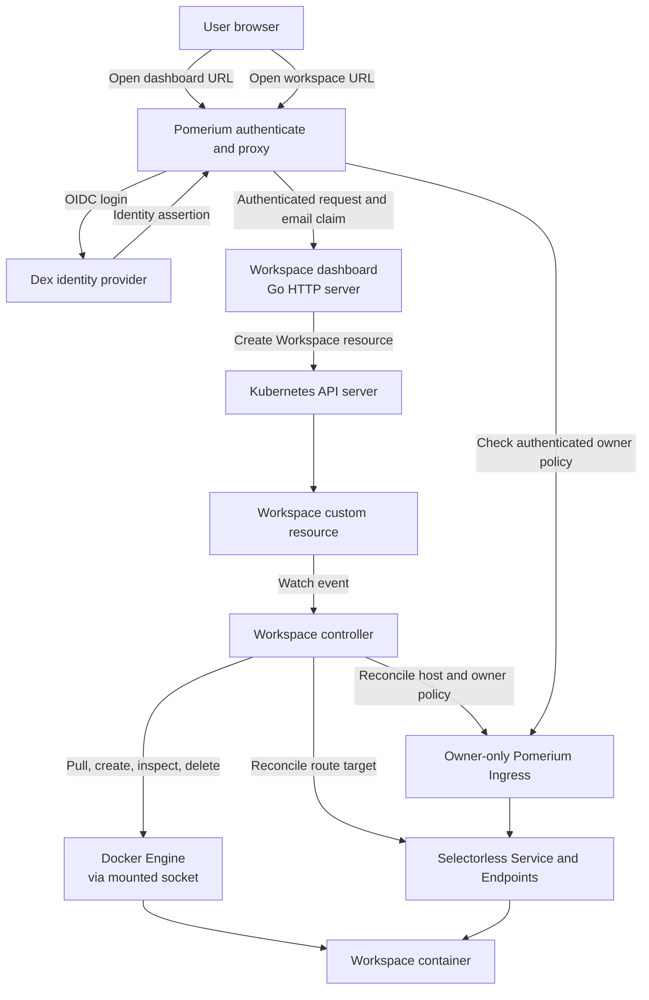

# Docker Workspaces

Docker Workspaces is a Kubernetes operator that represents a development
workspace as a namespaced `Workspace` custom resource and runs the workspace as
a Docker container. The operator watches each resource, creates and monitors its
container, publishes a stable URL through Pomerium, and removes the container
when the resource is deleted.

The repository also includes an authenticated web dashboard for creating,
opening, refreshing, and deleting a user's own Workspaces. The dashboard creates
Kubernetes resources through the Kubernetes API; it does not create containers
directly.

> **Scope and security:** this project is currently designed for a trusted local
> development environment using Docker and Kind. The manager mounts the Docker
> socket, which grants powerful control over the Docker host. It is not a
> hardened multi-tenant or production deployment. In particular,
> dashboard-created code-server runs with code-server authentication disabled;
> its hostname must remain protected by Pomerium authentication and the
> owner-only authorization policy.

## What it does

- Defines the `workspaces.example.com/v1alpha1` Kubernetes API.
- Validates Workspace names, owners, and supported image repositories through
  the CRD schema and admission webhook.
- Reconciles each Workspace into a Docker container with ownership labels and a
  finalizer for container cleanup.
- Creates a selectorless Kubernetes Service and Endpoints pointing to the
  container's IP on the Kind Docker network.
- Uses the core `Endpoints` resource for Pomerium backend discovery; Kubernetes
  mirrors it into EndpointSlices for modern API consumers.
- Creates an owner-only Pomerium Ingress at
  `https://<workspace-name>.localhost.pomerium.io`.
- Serves a Pomerium-protected dashboard at
  `https://workspaces.localhost.pomerium.io`.

The admission webhook supports `traefik/whoami` and `codercom/code-server`.
The dashboard currently offers only `codercom/code-server`, on port `8080`.

## Architecture and request flow



### Creating and running a Workspace

1. A user signs in to the dashboard through Pomerium and Dex.
2. The browser submits the Workspace name and selected image to
   `POST /api/workspaces`.
3. The dashboard reads the user's email from Pomerium's
   `X-Pomerium-Claim-Email` identity header. It validates the request and creates
   a `Workspace` custom resource using the Kubernetes client. The owner is
   derived from the authenticated identity, not from user input.
4. The Kubernetes API applies CRD and admission validation/defaulting, then
   persists the resource.
5. The controller receives the watch event, adds its container-cleanup
   finalizer, and asks the Docker provider to pull/create/start the container.
6. The controller inspects the container, records its IP and status, and
   reconciles a selectorless Service, Endpoints, and Pomerium Ingress.
   The installed Pomerium ingress controller discovers backends from core
   `Endpoints`, which Kubernetes mirrors into EndpointSlices.
7. When the container is running, the Workspace status contains its
   `https://<name>.localhost.pomerium.io` URL. The dashboard refreshes the
   Workspace list and offers an **Open** link.
8. Pomerium authenticates requests for the Workspace URL and allows only the
   Workspace owner before forwarding traffic to the container.

### Deleting a Workspace

The dashboard sends `DELETE /api/workspaces/{name}`. The server verifies the
Pomerium identity, same-origin request, and Workspace ownership before asking
Kubernetes to delete the custom resource. Kubernetes marks it for deletion. The
controller's finalizer removes the Docker container; only after cleanup
succeeds does the controller remove the finalizer and allow Kubernetes to
finish deleting the resource and its owned routing resources.

## Workspace API

The API type and schema are defined in
[`api/v1alpha1/workspace_types.go`](api/v1alpha1/workspace_types.go). A
Workspace is a Kubernetes custom resource, not a Pod. The controller runs the
workload as a Docker container and records observed state in `.status`.

Important fields:

| Field | Purpose |
|---|---|
| `metadata.name` | DNS-compatible Workspace name; also used in its URL. |
| `spec.owner` | Owner email address. The webhook prevents changing it after creation. |
| `spec.image` | Supported container image. The webhook defaults an omitted image to `traefik/whoami`. |
| `spec.port` | Container TCP port; defaults to `80` in the CRD. |
| `spec.args` | Optional command arguments passed to the container. |
| `status.phase` | Observed phase such as `Pending`, `Creating`, or `Running`. |
| `status.url` | Pomerium URL when the Workspace is running. |
| `status.ip` / `status.containerID` | Observed Docker container details. |

Create a sample resource directly:

```sh
kubectl apply -f config/samples/workspaces_v1alpha1_workspace.yaml
kubectl get workspaces
kubectl get workspace alice -o yaml
```

The checked-in generic sample uses `traefik/whoami`. For a code-server example,
apply the separate example:

```sh
kubectl apply -f config/samples/ide.yaml
```

To delete a directly-created resource:

```sh
kubectl delete workspace alice
```

Use the actual resource name in these examples. The short name `ws` is also
registered, so `kubectl get ws` is equivalent to `kubectl get workspaces`.

## Dashboard

Open [https://workspaces.localhost.pomerium.io](https://workspaces.localhost.pomerium.io)
after completing the Pomerium identity-provider setup.

The dashboard lets an authenticated user:

- Create a code-server Workspace by entering a Kubernetes-compatible name.
- See only Workspaces whose `spec.owner` matches their authenticated email.
- Refresh the list manually or let it poll for status updates every 10 seconds.
- Open Workspaces once their phase is `Running`.
- Delete their own Workspaces after confirming the action.
- Sign out through Pomerium and return to the authentication endpoint.

The dashboard API is served by the manager:

| Method | Path | Purpose |
|---|---|---|
| `GET` | `/api/workspaces` | List Workspaces owned by the authenticated user. |
| `POST` | `/api/workspaces` | Create a code-server Workspace. |
| `DELETE` | `/api/workspaces/{name}` | Delete an owned Workspace. |

The API is intended to be reached through Pomerium. The dashboard server checks
the identity email header; mutating requests additionally require the configured
dashboard `Origin`.

Dashboard-created code-server resources use port `8080` and these arguments:
`--bind-addr 0.0.0.0:8080 --auth none`. Pomerium is responsible for
authentication and the generated Ingress applies the owner-only policy. Do not
expose the container or its Service outside that protected route.

## Prerequisites

For the local Kind workflow:

- Go version from `go.mod` (the project scaffold currently documents Go 1.24.6
  or newer).
- Docker Engine, `kubectl`, and Kind.
- A Docker daemon accessible to the Kind node and controller manager through
  `/var/run/docker.sock`.
- cert-manager for the controller webhook certificates.
- Pomerium with its ingress controller and an OIDC identity provider for the
  dashboard and Workspace URLs.

The sample local cluster definition is
[`hack/kind-config.yaml`](hack/kind-config.yaml). It maps localhost ports 80
and 443 to the Kind control-plane node and mounts the host Docker socket into
that node.

## Local development setup

### 1. Create or select a Kind cluster

The redeploy script defaults to a cluster named `docker-workspaces`:

```sh
kind create cluster --name docker-workspaces --config hack/kind-config.yaml
kubectl config use-context kind-docker-workspaces
```

If the cluster already exists, keep using it rather than creating another. The
manager's Docker provider expects a Docker network named `kind`; the checked-in
Kind setup creates that network as part of the cluster.

### 2. Install cluster dependencies

Install cert-manager and Pomerium using their supported installation
instructions, or use local development manifests if you maintain them in your
working copy. Configure Pomerium with:

- The authenticate URL `https://authenticate.localhost.pomerium.io`.
- An OIDC provider and credentials.
- A certificate valid for `*.localhost.pomerium.io`, trusted by your browser
  and by Pomerium for the provider connection.
- DNS resolution for the local hostnames to the Pomerium proxy.

For the local development setup, apply the Pomerium base first to create its
namespace and CRDs. The checked-in `hack/auth/tls.yaml` and
`hack/auth/coredns.yaml` are optional local-cluster examples; review their
effects before applying. Dex account configuration is kept in the untracked,
git-ignored `hack/auth/dex.yaml` because it contains local client credentials
and password hashes. Create that file for your environment, then apply the
local CA, Dex provider, and global Pomerium configuration:

```sh
kubectl apply -k hack/pomerium
kubectl apply -f hack/auth/tls.yaml
kubectl -n pomerium wait --for=condition=Ready certificate/local-ca --timeout=120s
kubectl apply -f hack/auth/dex.yaml
kubectl apply -f hack/pomerium/global.yaml
```

Apply the local CoreDNS rewrite only if Pods need to resolve the
`*.localhost.pomerium.io` names through the Pomerium Service:

```sh
kubectl apply -f hack/auth/coredns.yaml
kubectl -n kube-system rollout restart deployment/coredns
```

The CoreDNS change affects DNS for the whole cluster. Inspect the proposed
Corefile and understand its effect before applying it to any shared cluster.

The Pomerium dashboard Ingress currently has an example allow policy for
`alice@example.com`, `bob@example.com`, `charlie@example.com`, and
`dana@example.com`. Change that allowlist to the identities appropriate for
your environment before use. To add a local Dex account, add a
`staticPasswords` entry with a unique user ID and bcrypt hash to
`hack/auth/dex.yaml`, add its email to the dashboard allowlist in
`hack/pomerium/dashboard.yaml`, and apply the updated files:

```sh
kubectl apply -f hack/auth/dex.yaml
kubectl -n dex rollout restart deployment/dex
kubectl apply -f hack/pomerium/dashboard.yaml
```

Generate bcrypt hashes locally with `htpasswd -nBC 10 <username>`; do not put
plaintext passwords in the manifest or commit local authentication files.
Workspace Ingresses are generated individually with a policy for the Workspace
owner.

The files under `hack/auth/` are development-only examples. The Dex config
contains local credentials and is intentionally not tracked. Review the
certificate and CoreDNS manifests and do not apply these examples to production
or shared clusters.

### 3. Build and deploy the operator

For an image registry accessible to your cluster:

```sh
make test
make docker-build docker-push IMG=<registry>/docker-workspace:<tag>
make deploy IMG=<registry>/docker-workspace:<tag>
```

For the local Kind cluster configured above, build, load, and redeploy the
development image:

```sh
bash hack/redeploy.sh
```

The script builds `mini-workspaces:dev`, loads it into the `docker-workspaces`
Kind cluster, applies the operator manifests, and waits for the manager rollout.
Set `CLUSTER=<kind-cluster-name>` if your Kind cluster has another name.

The operator manifests install the Workspace CRD, manager RBAC, webhook
certificates, manager, dashboard Service, and dashboard NetworkPolicy.

### 4. Create and verify a Workspace

Create a Workspace using a sample or the dashboard:

```sh
kubectl apply -f config/samples/ide.yaml
kubectl get ws -w
```

When the phase becomes `Running`, inspect its URL:

```sh
kubectl get ws ide -o jsonpath='{.status.url}{"\n"}'
```

The URL should be `https://ide.localhost.pomerium.io` when using the sample
name. It requires successful DNS and TLS setup and the configured Pomerium
owner policy.

## Troubleshooting

### Kubernetes reports that `ws` or `workspaces` is an unknown resource

The Workspace CRD is not installed in the current cluster/context:

```sh
kubectl config current-context
kubectl get crd workspaces.workspaces.example.com
make install
```

### A Workspace stays Pending or Creating

Check the Workspace status, controller logs, and the Docker socket mount:

```sh
kubectl get ws <name> -o yaml
kubectl logs -n docker-workspace-system deployment/docker-workspace-controller-manager
kubectl describe pod -n docker-workspace-system \
  -l control-plane=controller-manager | grep -n -C 2 -E 'docker-sock|/var/run/docker.sock'
docker exec docker-workspaces-control-plane sh -c 'test -S /var/run/docker.sock'
```

Also verify that the manager can reach a Docker daemon and that the expected
image can be pulled. The controller's finalizer intentionally keeps a deleting
Workspace present until Docker container cleanup succeeds.

### A Workspace URL does not resolve or does not reach the container

Check that the generated Ingress has class `pomerium`, that the Workspace
status contains the expected URL and container IP, and that Pomerium is
accepting routes:

```sh
kubectl get ingress -A
kubectl get svc,endpoints -n <namespace> <name>
kubectl get ws <name> -o jsonpath='{.status.phase}{" "}{.status.ip}{" "}{.status.url}{"\n"}'
kubectl logs -n pomerium deployment/pomerium
```

For browser access, also verify the local hostname resolves to the Pomerium
proxy and that the browser trusts the certificate for
`*.localhost.pomerium.io`.

### Code-server shows its own password prompt

The running container may have been created before the Workspace arguments
were configured. This controller does not recreate a running container just
because `spec.args` changes. Delete and recreate the Workspace with the
code-server arguments shown in [`config/samples/ide.yaml`](config/samples/ide.yaml)
or use the dashboard. Deletion removes the Docker container and its local
container filesystem; save any needed data first. Confirm the hostname still
routes through Pomerium before using `--auth none`.

### The dashboard redirects to login or reports an authentication error

Verify the dashboard Ingress exists, the identity provider is healthy, and the
email claim is being forwarded as `X-Pomerium-Claim-Email`. The configured
dashboard allowlist must also include the signed-in user's email:

```sh
kubectl get ingress -n docker-workspace-system workspace-dashboard -o yaml
kubectl logs -n pomerium deployment/pomerium
kubectl logs -n docker-workspace-system deployment/docker-workspace-controller-manager
```

## Configuration and security notes

- The Docker provider connects to the daemon using Docker's environment-based
  client configuration. The manager's deployment mounts
  `/var/run/docker.sock` from the node, so anyone able to control that socket
  may effectively control the Docker host.
- Workspace containers currently have no persistent volume configuration.
  Treat files stored only inside a container as temporary; deleting a Workspace
  removes its container and its container-local filesystem.
- Workspaces run in Docker on the Kind network, not as Kubernetes Pods. This
  deployment model assumes the manager and Docker engine share the expected
  network and socket.
- The dashboard is exposed through a ClusterIP Service on port `8082`. Its
  NetworkPolicy permits that port only from the Pomerium namespace.
- The dashboard derives owner identity from Pomerium's email claim and does not
  accept an owner from the create request. Listing and deletion are scoped to
  that owner.
- The webhook allows only the configured image repositories and prevents owner
  changes on update. It defaults an omitted image to `traefik/whoami`; dashboard
  creation independently selects code-server.
- Code-server's own authentication is disabled for dashboard-created
  Workspaces. Pomerium must remain the only path to the Workspace URL, and the
  owner-only Pomerium policy must be correct.
- The local Dex sample configuration is for development only. Replace demo
  credentials, secrets, certificates, and allowlists before adapting any setup
  for shared environments.

## Tests and generated files

Run the unit and integration-style envtest suite:

```sh
make test
```

`make test` regenerates CRD/RBAC/webhook manifests and deep-copy code, formats
the Go files, runs `go vet`, and runs Go tests with coverage. E2E tests use an
isolated Kind cluster; do not run them against a development or production
cluster:

```sh
make test-e2e
```

Other useful targets:

```sh
make help
make manifests
make generate
make lint
make build
```

Do not edit generated files by hand. Update API types and markers, then run
`make manifests` and `make generate` as appropriate.

## Uninstall

Delete Workspace custom resources first so their finalizers can clean up Docker
containers:

```sh
kubectl delete workspaces --all --all-namespaces
make undeploy
make uninstall
```

`make uninstall` removes the CRD; deleting a CRD also removes all remaining
Workspace resources, so do not uninstall it before considering container
cleanup. Remove Pomerium, cert-manager, and the Kind cluster separately if they
were created only for this project.

## Project layout

| Path | Contents |
|---|---|
| `api/v1alpha1/` | Workspace API types and generated deep-copy implementation. |
| `internal/controller/` | Workspace reconciliation and Pomerium Service, Endpoints, and Ingress routing. |
| `internal/compute/` | Docker Engine provider and container lifecycle operations. |
| `internal/dashboard/` | Authenticated dashboard HTTP server, API, HTML/JavaScript, and tests. |
| `internal/webhook/v1alpha1/` | Workspace image defaulting and validation. |
| `config/` | CRD, RBAC, manager, webhook, and sample Kubernetes configuration. |
| `hack/pomerium/` | Local Pomerium ingress-controller configuration and dashboard route. |
| `hack/redeploy.sh` | Local Kind build/load/deploy helper. |
| `test/e2e/` | End-to-end tests intended for an isolated Kind cluster. |
