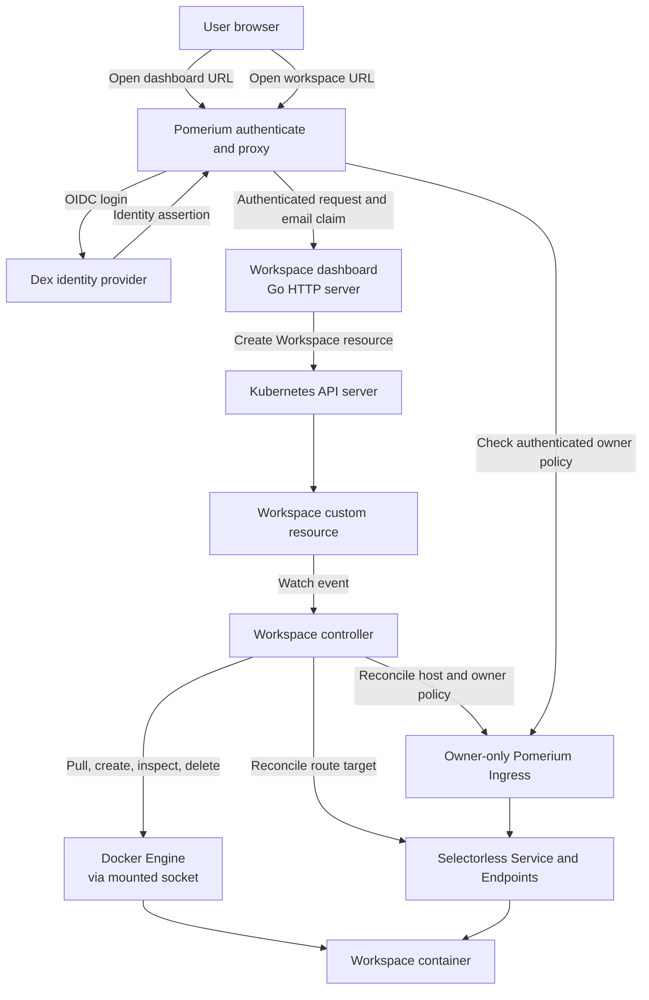

# Docker Workspaces

Docker Workspaces is a Kubernetes operator for creating browser-accessible
development environments from `Workspace` resources. A dashboard lets users
create, open, and delete their workspaces.

## How it works

The operator creates and manages a workspace container through the Docker
daemon available to the cluster. The dashboard and workspace URLs are routed
through an authenticated proxy. In the included local setup, those URLs resolve
only on the development machine; they are not public internet endpoints.

## Architecture



## Getting started

See the [local development guide](docs/local-development.md) to create a Kind
cluster, configure local authentication and routing, and deploy the operator.

Useful development commands:

```sh
make test
make lint
make test-e2e
```

End-to-end tests create and delete their own Kind cluster. Run them only when
that isolated cluster can safely be created on your machine.

## Security and production considerations

This project is intended for local development and learning. The current
controller uses the Docker socket, which grants broad control over its Docker
host, and workspace editor containers rely on the authenticated proxy for
access control. It does not yet provide hardened workload isolation or
persistent workspace storage.

Before deploying for multiple users, review the [security and production
considerations](docs/security-and-production.md) and design suitable
isolation, access control, storage, and operational safeguards.

## Project layout

- `api/` and `internal/`: Workspace API and controller.
- `config/`: Kubernetes resources, samples, and local development configuration.
- `dashboard/`: Workspace dashboard.
- `docs/`: Development and security guidance.
- `scripts/`: Local development helpers.
